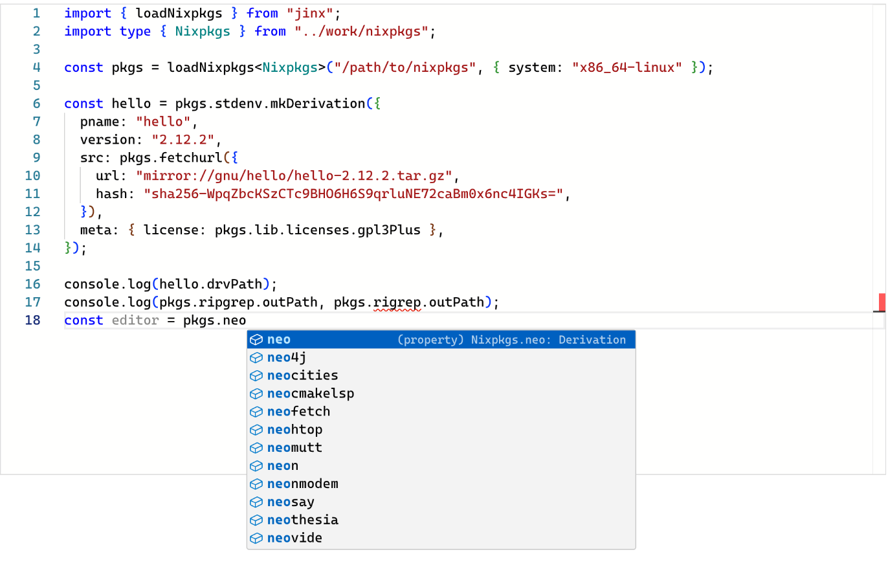

# Why

Nix evaluates nixpkgs with an interpreter, and an interpreter gives you
a value. jinx gives you a program, and the tools built for TypeScript
work on it.

## Profile an evaluation

`node --cpu-prof` on `firefox.drvPath`, folded through the source maps
so every frame is a line of nixpkgs:

<object data="./flamegraph-firefox.svg" type="image/svg+xml" style="width: 100%"></object>

Hover a frame for its share. The widest frames are `lib.makeOverridable`
in `lib/customisation.nix` and the firefox wrapper, and the module
system's `make-derivation.nix`. `pandoc` under the wrapper is a tenth of
the run: that is where `hackage-packages.nix` gets loaded.

```console
$ node --cpu-prof --cpu-prof-dir=prof src/cli/main.ts eval firefox.nix
$ node tools/flamegraph.ts --nix-only prof/*.cpuprofile > stacks.folded
$ flamegraph.pl stacks.folded > flamegraph.svg
```

## Complete nixpkgs in the editor

`tools/gen-nixpkgs-dts.ts` writes a declaration file for a package set:
every attribute, `lib`'s functions with their documented signatures,
and the shape of a derivation. With it, `pkgs.` completes and a
misspelled attribute is an error before anything runs.



## Step through a package

Source maps put a breakpoint on a `.nix` line. Open the compiled tree
in VS Code or Chrome DevTools, break in `pkgs/by-name/he/hello/package.nix`,
and step into `stdenv.mkDerivation` as it builds the attribute set.

```console
$ node --inspect-brk --enable-source-maps src/cli/main.ts eval hello.nix
```

## Query nixpkgs in a loop

A view of nixpkgs is an object, so a question about it is a loop:

```ts
import { loadNixpkgs } from "jinx";

const pkgs = loadNixpkgs("/path/to/nixpkgs");
const gpl = [];
for (const name of Object.keys(pkgs.lib.licenses)) {
  if (pkgs.lib.licenses[name].spdxId?.startsWith("GPL")) {
    gpl.push(name);
  }
}
console.log(JSON.stringify(gpl));
```

## Test Nix with node:test

A `lib` function or a package definition is a function in a module, so
it has a unit test:

```ts
import { test } from "node:test";
import assert from "node:assert/strict";
import { loadNixpkgs } from "jinx";

const pkgs = loadNixpkgs("/path/to/nixpkgs");

test("hello builds the derivation Nix would", () => {
  assert.equal(
    pkgs.hello.drvPath,
    "/nix/store/cnraiw0hbdl6jzdhbkn8dah2hqj7xgij-hello-2.12.3.drv",
  );
});
```

## Run it in a browser

The [nixpkgs page](../nixpkgs/) evaluates attributes of the compiled
nixpkgs in the tab, fetching the modules it needs, and the
[playground](../) compiles and runs a snippet as you type.
